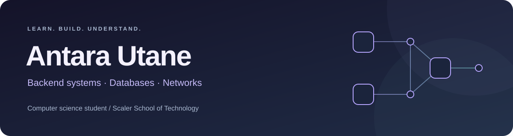

  

  <b>Exploring how software works beneath the surface.</b> 
  Java &amp; Python · Backend development · Computer science fundamentals

  <a href="#selected-work">Selected work</a> &nbsp; / &nbsp;
  <a href="#my-toolbox">My toolbox</a> &nbsp; / &nbsp;
  <a href="#currently-exploring">Currently exploring</a>

 

### A little about me

I'm **Antara**, a computer science student at **Scaler School of Technology**. My projects explore search suggestions, network protocols, and expense-review workflows.

I'm interested in the decisions behind the code: how data moves, what happens when something fails, and how to test the result.

 

## Selected work

<table>
<tr>
<td width="50%" valign="top">
<h3>01 &nbsp; Search Typeahead</h3>

<strong>Search suggestions, from cache to database.</strong>

Prefix-based suggestions with PostgreSQL storage, Redis caching, batched search-count updates, and a React interface.

<code>Java</code> <code>Spring Boot</code> <code>PostgreSQL</code> <code>Redis</code>

<a href="https://github.com/Aana-1025/Search-Typehead">Explore repository ↗</a> &nbsp; · &nbsp; <a href="https://github.com/Aana-1025/Search-Typehead/blob/main/docs/architecture.md">Architecture</a>

</td>
<td width="50%" valign="top">
<h3>02 &nbsp; HTTP in Binary</h3>

<strong>A closer look at what travels over the wire.</strong>

A TCP client and server using a custom binary file-transfer protocol, with frame parsing, persistent connections, path validation, and tests.

<code>Python</code> <code>TCP sockets</code> <code>Binary protocols</code>

<a href="https://github.com/Aana-1025/http-in-binary">Explore repository ↗</a> &nbsp; · &nbsp; <a href="https://github.com/Aana-1025/http-in-binary/blob/main/SPEC.md">Protocol spec</a>

</td>
</tr>
<tr>
<td colspan="2" valign="top">
<h3>03 &nbsp; AuditGuard</h3>

<strong>Making expense review easier to inspect.</strong>

An expense-auditing prototype combining rules for suspicious transactions, a review dashboard, and a simulated audit workflow.

<code>Python</code> <code>FastAPI</code> <code>React</code> <code>Rule-based checks</code>

<a href="https://github.com/Aana-1025/AuditGuard-AI">Explore repository ↗</a>

</td>
</tr>
</table>

These repositories include coursework and prototypes. Each project documents its scope and setup.

 

## My toolbox

Technologies used across my projects:

  
  
  
  
  

  
  
  
  
  

 

## Currently exploring

- **Reliability** — background processing and recovery after failures.
- **Data systems** — cache behavior, database tradeoffs, and reproducible measurements.
- **Networking** — protocol design and defensive input handling.
- **AI-assisted development** — reviewing generated code and checking it with meaningful tests.

 

---

Thanks for stopping by. Explore a project, read the design, and follow the code.

